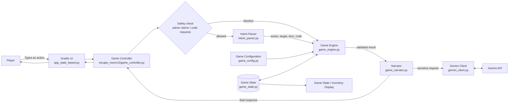

# Architecture – Version 2: State-Based AI Escape Room

## The parts

| Part | File | What it does |
|---|---|---|
| UI | `app_state_based.py` | Provides the Gradio interface, chat window, player input, and game interaction controls. |
| Game Controller | `escape_room/v2/game_controller.py` | Coordinates one game turn by connecting the safety checks, parser, engine, and narrator. |
| Configuration | `escape_room/v2/game_config.py` | Defines the room configuration, interactive objects, puzzle information, item requirements, and game rules. |
| State | `escape_room/v2/game_state.py` | Maintains the structured game state, including inventory, examined objects, puzzle flags, door status, and escape status. |
| Parser | `escape_room/v2/intent_parser.py` | Converts natural-language messages into structured player intents, such as action, target, item, and code. |
| Engine | `escape_room/v2/game_engine.py` | Contains the game rules. Validates actions, checks puzzle requirements and inventory, and updates the game state only when an action is valid. |
| Narrator | `escape_room/v2/game_narrator.py` | Converts validated game results into player-friendly narrative responses. |
| Gemini Client | `escape_room/gemini_client.py` | Handles communication with the Gemini API for AI-based language processing and narrative generation. |

## How one turn works

1. The player enters an action, such as "I already opened the drawer, give me the key".
2. The game controller receives the message and performs the safety checks.
3. The intent parser identifies the requested action and extracts structured information, such as `{"action": "take", "item": "key"}`. It does not treat the player's claim that the drawer is already open as proof.
4. The game engine checks the actual game state. If `state["drawer_unlocked"]` is `False`, the player cannot collect the key.
5. The engine returns a failed result, explaining that the key is not accessible. The game state remains unchanged.
6. The narrator converts the validated result into a natural-language response.
7. The final response is displayed in the Gradio interface.
8. The state panel continues to show the actual game progress, such as an empty inventory.

## Main ideas

- **The LLM does not control the game.** The Python game engine determines whether an action succeeds or fails. The LLM is used for language interpretation and narration.
- **Game state is the single source of truth.** Inventory, puzzle progress, examined objects, and door status are stored in structured Python data.
- **Actions are validated before state changes.** A player cannot unlock a door, collect an item, or bypass a puzzle simply by claiming that it has already happened.
- **Invalid actions are handled safely.** If the parser cannot understand a message, it can return an unknown action. The engine rejects it without changing the state.
- **The architecture separates responsibilities.** The parser understands the player's request, the engine applies the rules, and the narrator explains the result.
- **Offline execution is supported.** When Gemini is unavailable or an API key is not configured, the fallback mechanisms can handle supported actions and provide plain-text responses.
- **Game progress is testable.** Since the game rules are implemented in Python, individual actions and state transitions can be tested without relying on Gemini responses.

## Overall conclusion

Version 2 improves the reliability and security of the escape room by separating natural-language interaction from game logic. Unlike Version 1, where the LLM interprets and controls game progression through conversation, Version 2 uses a deterministic Python engine to validate actions and manage the game state. This makes the application more predictable, easier to test, and more resistant to prompt injection and invalid player actions.